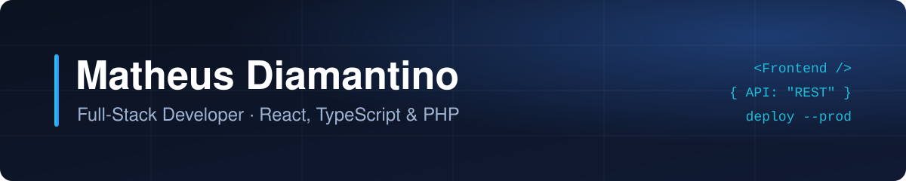

  
  
  

Sou desenvolvedor full-stack em Barueri/SP. Trabalho na **UX Group**, onde desenvolvo widgets de gamificação para as casas Reals, Bingo e BetGo, integrados à Smartico. Fora do trabalho, faço projetos completos: do design ao servidor.

### Em destaque

**[Reedificando o Altar](https://github.com/MatheusDiamantino/reedificando-o-altar)** · [ver no ar](https://reedificandooaltar.com.br) 
Site, painel e API de uma igreja. Cena 3D guiada pela rolagem, páginas pré-geradas para o Google e login com Argon2id, CSRF e limite de tentativas. 
`React 19` `TypeScript` `Three.js` `GSAP` `PHP` `Slim 4` `MySQL`

### Outros projetos

- **[Tournament Leaderboard](https://github.com/MatheusDiamantino/tournament-leaderboard)**: ranking de torneios com metas de jackpot, feito para a UX Group
- **[Spooky Rewards](https://github.com/MatheusDiamantino/spooky-rewards-widget)** e **[Realsday Christmas](https://github.com/MatheusDiamantino/realsday-christmas-smartico)**: campanhas de gamificação com missões, níveis e torneios
- **[TalentFlow](https://github.com/MatheusDiamantino/TalentFlow)**: sistema de RH em Laravel com perfis de acesso e convite por e-mail
- **[Agenda Livewire](https://github.com/MatheusDiamantino/Livewire)**: CRUD com busca em tempo real em Laravel e Livewire

### Tecnologias

